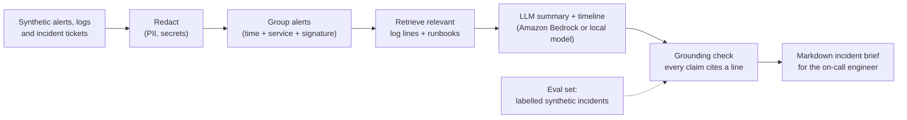

# aiops-incident-assistant

> **Status: in progress.** Design and plan only; first working version targeted for December 2026. Nothing below is claimed to work yet.

**An LLM-assisted triage helper: groups noisy alerts into likely incidents and drafts a first-pass summary and RCA timeline that cites the exact log lines it used, so the on-call engineer starts from evidence instead of a blank page.**

**What this will show**

- **The problem:** during an incident, the first 20–30 minutes [CONFIRM: drop or replace this number] go into reading alerts and logs across application, network and certificate layers before anyone can say what is actually broken.
- **The SRE skill:** incident response and root-cause analysis, alert correlation, and GenAI/LLM ops done carefully: grounded answers with citations, PII redaction, no automatic actions, and an evaluation harness that scores summaries against labelled incidents.
- **The business impact:** faster, more consistent triage and better post-incident write-ups, with a human always making the call.

> Demo screenshot / GIF: added with v0.1.

## Planned features (v0.1)

- [ ] Synthetic incident generator: a small multi-service app's logs and alerts with injected faults (connection resets, certificate expiry, a bad deploy, a downstream timeout).
- [ ] Alert grouping by time window, service and error signature, without an LLM.
- [ ] Incident brief: summary, suspected component, timeline and "what to check next", each line citing source log lines.
- [ ] Guardrails: redaction before anything leaves the box, read-only (no remediation actions), refusal when evidence is thin.
- [ ] Pluggable model backend: Amazon Bedrock or a local model; a fake backend for tests and CI.
- [ ] Evaluation harness: scores briefs against labelled incidents for correct component, grounded claims and hallucinated claims.
- [ ] `make demo` that runs end to end on synthetic data with the fake backend; tests and CI like [slo-toolkit](https://github.com/mahidhar-salla/slo-toolkit).

## Why I'm building this

As a Senior Site Reliability Engineer, I've led root-cause analysis across application, TLS and network layers, and I've used Python and machine-learning methods to prepare incident records for analysis and built reusable LLM agents for operational workflows. The pattern I keep seeing is that the evidence is there; it's just scattered. This project is a public, from-scratch take on that problem: synthetic data only, no employer or client code, configuration, data or names.

## Not in scope

Auto-remediation, paging integrations, or anything that acts on production. This is a reading and writing assistant for humans.

## License

[MIT](LICENSE) © 2026 Mahidhar Chowdhary Salla
