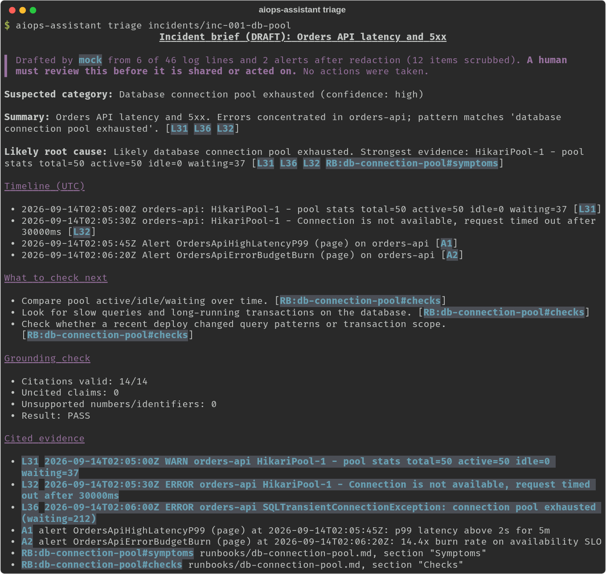
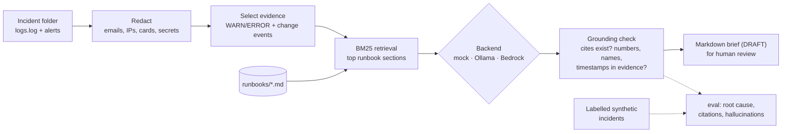

# aiops-incident-assistant

[](https://github.com/mahidhar-salla/aiops-incident-assistant/actions/workflows/ci.yml)
[](LICENSE)


**Point it at an incident's logs and alerts. It scrubs PII, pulls the matching runbook sections, and drafts a summary, likely root cause and timeline where every line cites the log line or runbook section it came from. Then it checks those citations before a human reads it.**

**What this shows**

- **The problem:** the first part of an incident goes into reading scattered alerts and logs before anyone can say what is broken, and LLM summaries that sound confident but can't be traced back to evidence make that worse, not better.
- **The SRE skill:** incident response and RCA, retrieval over runbooks (RAG) with citations, PII redaction before anything reaches a model, and GenAI/LLM ops done like any other dependency: pluggable backends (Amazon Bedrock, Ollama), an offline mock for CI, and an eval harness that scores root-cause match, citation validity and hallucinations on labelled incidents.
- **The business impact:** the on-call engineer starts from a cited draft instead of a blank page, and every claim can be checked in seconds. It never acts on anything; a person makes every call.


<sub>`make demo` output for a synthetic incident, offline mock backend. Every `L`, `A` and `RB:` id points at an exact log line, alert or runbook section.</sub>



## Quick start

Needs Python 3.11+ and `make`. No network, API keys or GPU.

```bash
git clone https://github.com/mahidhar-salla/aiops-incident-assistant && cd aiops-incident-assistant
make demo
```

`make demo` installs into a local `.venv`, lists the 11 synthetic incidents, shows what redaction does to a log file, drafts a brief for one incident and runs the eval with the offline `mock` backend.

With a local model through [Ollama](https://ollama.com):

```bash
ollama pull qwen2.5:1.5b
make eval-ollama                        # or: make demo BACKEND=ollama MODEL=qwen2.5:1.5b
aiops-assistant triage incidents/inc-004-dns -b ollama -m qwen2.5:1.5b
```

With Amazon Bedrock (credentials come from the standard AWS chain: env vars, `~/.aws` profile, SSO or an IAM role; nothing is read from this repo):

```bash
.venv/bin/pip install -e ".[bedrock]"
AWS_PROFILE=my-profile AWS_REGION=us-east-1 \
  aiops-assistant triage incidents/inc-004-dns -b bedrock -m anthropic.claude-3-haiku-20240307-v1:0
```

The Bedrock backend uses the Converse API and is covered by unit tests for its failure path only. I haven't run it against a live AWS account for this release.

## Commands

| Command | What it does |
|---|---|
| `aiops-assistant triage <incident>` | Draft a cited brief, run the grounding check, print Markdown (`-o` to save). Exits 2 if the check fails. |
| `aiops-assistant triage <incident> --show-prompt` | Print the exact redacted prompt a model would receive. Nothing is sent. |
| `aiops-assistant eval` | Score a backend on every labelled incident (`-o` writes JSON). |
| `aiops-assistant redact <file>` | Show a file the way a model would see it. |
| `aiops-assistant list` / `synth` | List or regenerate the synthetic incidents. |

All take `-b mock|ollama|bedrock` and `-m <model>` where relevant.

## Evaluation

11 labelled synthetic incidents in [`incidents/`](incidents/): connection pool exhaustion, TLS cert expiry, a bad deploy, DNS, disk full, Kafka consumer lag, OOMKilled from a memory leak, a slow dependency, upstream 429 rate limiting, a credential rotation mismatch, and one noise-only case where the right answer is "not enough evidence". Labels (`label.yaml`) are never shown to the backend.

| Metric | What it checks |
|---|---|
| Root cause | Predicted category equals the label |
| Key evidence cited | At least one cited line is a labelled key line |
| Citation validity | Share of cited ids that exist in the evidence the backend was given |
| Hallucination-free | No invalid cites, and every number, hyphenated name (e.g. a service) and timeline timestamp appears in the evidence |

Results from this repo (Oct 13, 2026, CPU only):

| Backend | Root cause | Key evidence | Citation validity | Hallucination-free | Parse failures | Time / incident |
|---|---|---|---|---|---|---|
| `mock` (rules + retrieval, no model) | 11/11 | 11/11 | 100% | 11/11 | 0 | <0.1 s |
| Ollama `qwen2.5:1.5b` (Q4_K_M) | 6/11 | 11/11 | 100% | 11/11 | 0 | 19.5 s |

Read these honestly:

- **The mock scoring 100% is a sanity check, not a result.** I wrote the incidents, the runbooks and the mock's rules, so they share vocabulary. It exists so CI and the demo run offline and so there's a floor to compare models against.
- **The 1.5B local model** cited real lines every time, but on 5 of 11 incidents it answered `unknown` even when its own root-cause text named the right cause (e.g. "DNS resolution failures" on the DNS incident). A larger model would likely do better; I haven't measured one yet.
- **The hallucination check is lexical.** It catches invented ids, numbers, service names and timestamps. It doesn't catch a real line cited for the wrong claim. That's what the human review is for.

Raw results: [`docs/eval/`](docs/eval/).

## Safety and cost

What it does: reads logs and alerts you give it, redacts them, and writes a draft. What it doesn't do: run commands, call your infrastructure, page anyone, or change anything. There's no auto-remediation, by design. Details in [docs/SAFETY.md](docs/SAFETY.md).

- **Human review is required.** Every brief is labelled DRAFT and lists the exact sources so they can be checked.
- **PII scrubbing before the model.** Emails, public IPs, card-like numbers, SIN/SSN-like numbers, bearer tokens, AWS keys and `password=`/`token=` values are replaced before the prompt is built. Routine INFO lines are dropped entirely. It's pattern-based, so treat it as one layer, not a guarantee.
- **Local first.** With `mock` or Ollama nothing leaves the machine. With Bedrock the redacted prompt goes to AWS in your account and region.
- **Cost.** Prompts here are about 2.8 to 3.7 thousand characters (the system prompt plus evidence), so roughly a thousand tokens in and a few hundred out per incident. Check current Bedrock pricing for your model and region; the mock and Ollama cost nothing beyond your own compute.

## Why I built this

As a Senior Site Reliability Engineer at a regulated lender, I've led root-cause analysis across application, TLS and network layers, and I've built reusable LLM agents for operational workflows. The evidence is usually there; it's just scattered, and an AI summary is only useful if you can check it quickly. This is a public, from-scratch take on that problem: synthetic data and generic runbooks only, no employer or client code, configuration, data or names.

## Layout

```
src/aiops_assistant/   redact, retrieval (BM25), evidence, prompt, backends/, grounding, evaluate, cli
incidents/             11 labelled synthetic incidents (generated by `aiops-assistant synth`)
runbooks/              10 generic runbooks, split into cited sections
docs/                  SAFETY.md, eval results, screenshots
```

## Not in scope

Auto-remediation, paging integrations, or anything that acts on production. See [ROADMAP.md](ROADMAP.md) for what's next.

## License

[MIT](LICENSE) © 2026 Mahidhar Salla
